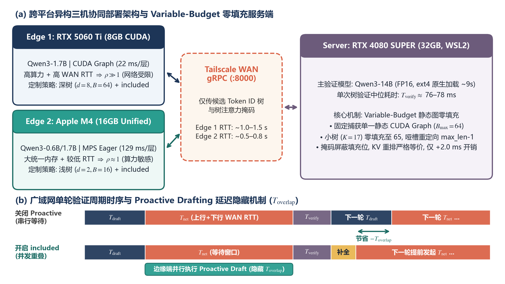
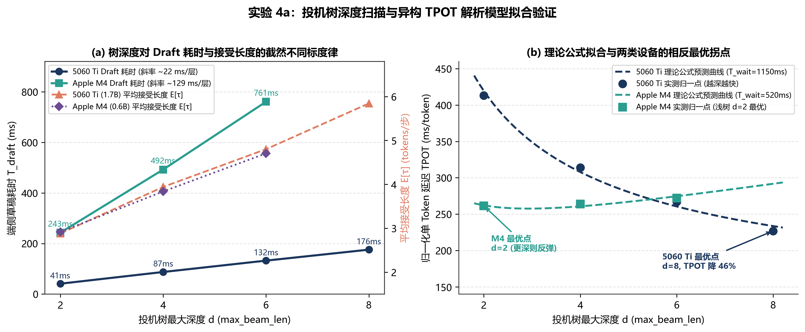
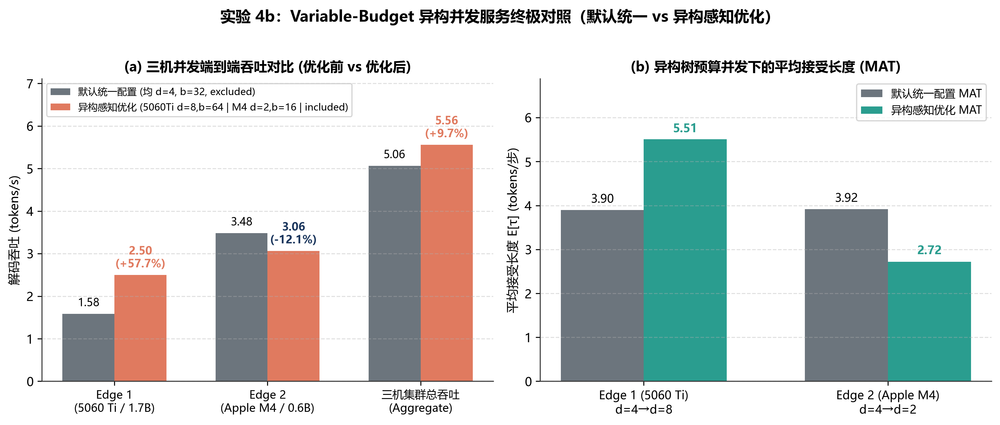

# SpecEdge-Hetero: 面向跨平台异构广域网集群的端边协同投机解码复现与优化

本项目基于 NeurIPS 2025 论文 **SpecEdge**（[`kaist-ina/specedge`](https://github.com/kaist-ina/specedge)）展开二次工程改造与控制变量实证研究，将原本仅面向“同构 Linux + NVIDIA CUDA + 10 GbE 局域网”的端边协同推理框架，扩展并优化至真实的**跨平台消费级异构广域网三机集群**（Windows + WSL2 + macOS，NVIDIA CUDA + Apple Silicon MPS，Tailscale 广域网组网）。

> 📄 **完整交付报告（IEEE Conference 双栏模板）**：
> - **英文 Workshop-Level 论文（严格 10pt / 12pt 行距，满足课程提交要求）**：[英文 IEEE 双栏 PDF](docs/ieee_paper_en.pdf) · [英文 `IEEEtran` LaTeX 源码 (`ieee_paper_en.tex`)](docs/ieee_paper_en.tex) · [英文矢量配图 (`docs/figures_en/`)](docs/figures_en/)
> - **中文配套报告与数据**：[中文 IEEE 双栏 PDF](docs/course_report.pdf) · [中文 LaTeX (`paper.tex`)](docs/paper.tex) · [Markdown 版本](docs/course_report.md) · [全量实测数据](docs/exp_summary.json)

---

## 为什么做这项改进？

原版 SpecEdge 在 10 GbE 局域网同构集群上表现优异，但在真实的消费级/实验室异构环境中会遇到三个核心痛点：
1. **平台锁定**：原版代码硬编码了 `torch.cuda.CUDAGraph` 与 `torch.cuda.synchronize`，无法在 Apple Silicon（macOS MPS）等主流轻薄本边缘设备上运行；
2. **统一树预算约束**：原版服务端静态 CUDA Graph 缓冲区要求所有并发 Edge 必须使用完全相同的 `max_budget`，迫使算力与网络 RTT 迥异的边缘节点采用“一刀切”的超参；
3. **广域网反直觉倒挂**：在真实 Tailscale 广域网下，算力更强但 RTT 更高的独显节点若沿用默认浅/中树配置，吞吐反而可能落后于算力更弱但链路更近的笔记本端。



---

## 核心贡献与代码改造

| 模块 | 修改文件 | 核心改进内容 |
| :--- | :--- | :--- |
| **Apple Silicon MPS 兼容层** | [`src/specedge/engine/graph.py`](src/specedge/engine/graph.py) | 按 `device.type` 自动分发，非 CUDA 端跳过 CUDA Graph 捕获；修复原版非图执行分支遗漏 `KVCache.seq_indices[:num_beams]` 切片导致的维度失配 bug |
| **跨后端同步计时** | [`src/util.py`](src/util.py) | 扩展 `Timing` 支持 `torch.mps.synchronize()`，非 CUDA 设备的 `event` 模式平滑回退至 `sync` |
| **Variable-Budget 静态图零填充** | [`src/strategy/server_verify/specexec/grpc.py`](src/strategy/server_verify/specexec/grpc.py) | 服务端仅捕获单一 `max_budget=64` 静态 CUDA Graph，对小预算树（如 `b=16`）自动零填充、重定向哑 KV 槽并屏蔽掩码，以仅 **+2.0 ms** 开销支持异构树预算并发验证 |
| **Windows 客户端退出加固** | [`src/script/client.py`](src/script/client.py) | 在请求循环结束后显式刷新日志并退出，解决 Windows Python 3.14 下 `grpc.aio` 后台线程挂起问题 |
| **IEEE 论文级绘图与双栏排版管线** | [`script/plot_report_figures.py`](script/plot_report_figures.py)、[`script/build_pdf.py`](script/build_pdf.py) | 从原始 `.jsonl` 一键生成 6 张学术配色 STIX 公式图表（PNG / SVG / PDF）及 6 页 **IEEE Conference (`IEEEtran`)** 双栏成稿 PDF（含三线表、编号公式与 Algorithm 1 伪代码） |

---

## 真实三机异构实验平台

| 节点角色 | 硬件与操作系统 | 推理后端 | 模型配置（FP16） | 核心特征 |
| :--- | :--- | :--- | :--- | :--- |
| **Server（主验证端）** | RTX 4080 SUPER（32 GB, `sm_89`）<br>Windows 11 + WSL2 Ubuntu | CUDA 12.8 + CUDA Graph | `Qwen/Qwen3-14B` | 专用主卡，单次树验证仅 `~75–85 ms` |
| **Edge 1（强算力 / 高 RTT）** | RTX 5060 Ti（8 GB, `sm_120`）<br>Windows 11 | CUDA 12.8 + CUDA Graph | `Qwen/Qwen3-1.7B` / `0.6B` | 草稿极快（`~22 ms/层`），瓶颈比 $\rho \in [10, 22]$（**网络受限型**） |
| **Edge 2（大内存 / 低 RTT）** | Apple M4（16 GB 统一内存）<br>macOS 27.2.1 (`arm64`) | PyTorch MPS（Eager） | `Qwen/Qwen3-0.6B` / `1.7B` | 调度开销高（`~129 ms/层`），瓶颈比 $\rho \in [1.0, 2.1]$（**算力敏感型**） |

---

## 关键实验结论（4 组控制变量实验，18 个实测点）

所有实验固定使用 `SpecBench` 相同 16 条请求（`max_len=2048`、`max_new_tokens=64`、`temperature=0.7`、`seed=42`）：

1. **单卡同驻 vs. 端边卸载（实验 1）**：单张 32 GB 4080S 同卡塞入 `14B + 0.6B`（`Server-Only`）时，因显存受限无法启用主模型 CUDA Graph，单次验证恶化至 `431.6 ms`（慢 `5.4×`）；将草稿卸载至边缘后，主端验证稳定在 `75–82 ms`。
2. **固定调度底噪摊销效应（实验 2）**：在 Apple M4 上将草稿模型从 `0.6B` 升至 `1.7B` 后，平均接受长度跃升至 `4.16`（+8.3%），有效摊薄了 MPS Eager 的固定发射底噪，吞吐反升 `+6.0%`（`2.62 → 2.78 tok/s`）。
3. **广域网下的 Proactive Drafting 消融（实验 3）**：在高 RTT 环境下，`included` 模式在两端均优于 `disabled` 与 `excluded`，在 5060 Ti 上压低 Draft `-18.7%` 并提速 `+17.0%`，在 M4 上压低 Draft `-14.6%` 并较默认模式提速 `+32.4%`。
4. **相反最优树深拐点与理论公式拟合（实验 4a）**：
   - 网络受限的 `5060 Ti`（$\rho \gg 1$）随树深单调加速，在 `(d=8, b=64)` 时平均接受长度达 **5.84**（最高单步接受 14 tokens），归一化 TPOT 下降 **45%**；
   - 算力敏感的 `Apple M4`（$\rho \approx 1$）在浅树 `(d=2, b=16)` 处达到最优（Draft 腰斩至 `242.7 ms`，吞吐达 **`3.55 tok/s`**），更深则反弹。



5. **异构感知三机并发终极对比（实验 4b）**：依托 Variable-Budget 零填充服务端，为 `5060 Ti` 分配 `(d=8, b=64, included)`、为 `Apple M4` 分配 `(d=2, b=16, included)`，相比统一默认配置 `(d=4, b=32, excluded)`：

| 指标 | 默认统一 SpecEdge | 异构感知优化 + Variable-Budget | 相对变化 |
| :--- | :---: | :---: | :---: |
| **Edge 1 (5060 Ti) MAT / RPC 次数** | 3.90 / 235 次 | **5.51 / 167 次** | **+41.3% / -28.9%** |
| **Edge 1 (5060 Ti) TPOT / 吞吐** | 631.7 ms / 1.58 tok/s | **400.6 ms / 2.50 tok/s** | **-36.6% / +57.7%** |
| **Edge 2 (Apple M4) 本地 Draft 耗时** | 481.7 ms | **173.5 ms** | **-64.0%** |
| **Server 14B 中位验证耗时** | 76.0 ms | **78.0 ms** | **仅 +2.0 ms** |
| **三机集群总吞吐（Aggregate）** | 5.06 tok/s | **5.56 tok/s** | **+9.7%** |
| **双端吞吐不均衡比（Max / Min）** | 2.20× | **1.23×** | **-44.1%** |



---

## 快速复现指南

### 1. 环境准备（`uv` 对齐 Python 3.14 / PyTorch 2.9 / Transformers 4.57）
```bash
# Linux (WSL2 Server) / macOS (Apple Silicon Edge)
uv sync

# Windows NVIDIA CUDA Edge（需指定 cu128 源以适配 RTX 50 系列 sm_120）
uv venv --python 3.14 .venv
uv pip install --python .venv\Scripts\python.exe --index-url https://download.pytorch.org/whl/cu128 --extra-index-url https://pypi.org/simple --index-strategy unsafe-best-match "torch~=2.9.0"
uv pip install --python .venv\Scripts\python.exe "accelerate~=1.10.0" "blobfile~=3.1.0" "fastchat>=0.1.0" "grpcio~=1.75.0" "protobuf>=6.30.0,<7" "matplotlib~=3.10.0" "plotly~=6.3.0" "polars~=1.34.0" "rich~=14.2.0" "sentencepiece~=0.2.0" "tiktoken~=0.12.0" "transformers~=4.57.0"
```

### 2. 启动三机协同推理
1. 参考 [`config/specedge_3node.example.yaml`](config/specedge_3node.example.yaml) 配置主模型路径（建议在 WSL2 原生 ext4 分区存放 `Qwen3-14B`）并开放服务端 gRPC `8000` 端口；
2. 服务端启动：
   ```bash
   .venv/bin/python -O src/script/batch_server.py --config config/specedge_3node.yaml
   ```
3. 边缘端分别运行 [`script/run_client_node.ps1`](script/run_client_node.ps1)（Windows CUDA）与 [`script/run_client_mac.sh`](script/run_client_mac.sh)（macOS MPS），或使用 [`script/run_3node_exp.ps1`](script/run_3node_exp.ps1) 传参一键调度。

### 3. 一键重绘全部图表与重新生成 PDF 报告
```bash
python script/plot_report_figures.py
python script/build_pdf.py
```

---

## 仓库目录结构

```text
├── config/
│   ├── specedge_3node.example.yaml   # 三机异构配置模板
│   └── *.example.yaml                # 原版基线配置模板
├── docs/
│   ├── ieee_paper_en.pdf             # 英文 IEEE Conference 双栏论文（10pt/12pt，课程提交主稿）
│   ├── ieee_paper_en.tex             # 英文 IEEEtran LaTeX 论文源码（Overleaf pdfLaTeX 直接编译）
│   ├── figures_en/                   # 6 张英文 IEEE 论文配图（PNG / SVG / PDF）
│   ├── course_report.pdf             # 中文 IEEE Conference 双栏成稿（6 页 PDF）
│   ├── paper.tex                     # 中文 IEEEtran LaTeX 论文源码（XeLaTeX）
│   ├── course_report.md              # 中文完整课程研究报告（Markdown）
│   ├── exp_summary.json              # 全部 18 组实测统计汇总
│   ├── reproduction_report.md        # 初期三机联调复现记录
│   └── figures/                      # 6 张中文论文配图（PNG / SVG / PDF）
├── script/
│   ├── run_client_node.ps1           # Windows CUDA 边缘端启动脚本
│   ├── run_client_mac.sh             # macOS MPS 边缘端启动脚本
│   ├── run_3node_exp.ps1             # 三机并发调度脚本
│   ├── plot_ieee_en_figures.py       # 6 张英文 IEEE 配图生成脚本
│   ├── build_ieee_en_pdf.py          # 英文 10pt/12pt IEEE 双栏 PDF 构建脚本
│   ├── plot_report_figures.py        # 6 张中文论文配图生成脚本
│   └── build_pdf.py                  # 中文 IEEE 双栏 PDF 构建脚本
└── src/                              # 含 MPS 兼容与 Variable-Budget 零填充改造的核心源码
```

---

## 致谢与上游声明

本项目核心框架源自 KAIST INA Lab 的开源项目 [`kaist-ina/specedge`](https://github.com/kaist-ina/specedge)（NeurIPS 2025），遵循原仓库 MIT 许可证。如使用基础框架请引用原论文：

```bibtex
@inproceedings{park2025specedge,
  author    = {Jinwoo Park and Seunggeun Cho and Dongsu Han},
  title     = {SpecEdge: Scalable Edge-Assisted Serving Framework for Interactive LLMs},
  booktitle = {Advances in Neural Information Processing Systems (NeurIPS)},
  year      = {2025},
  eprint    = {2505.17052},
  archivePrefix = {arXiv},
  primaryClass  = {cs.CL}
}
```
