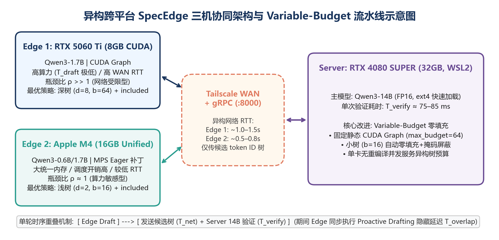
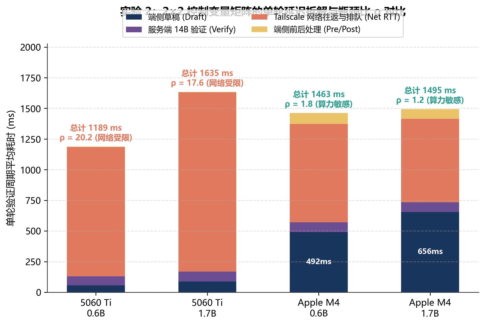
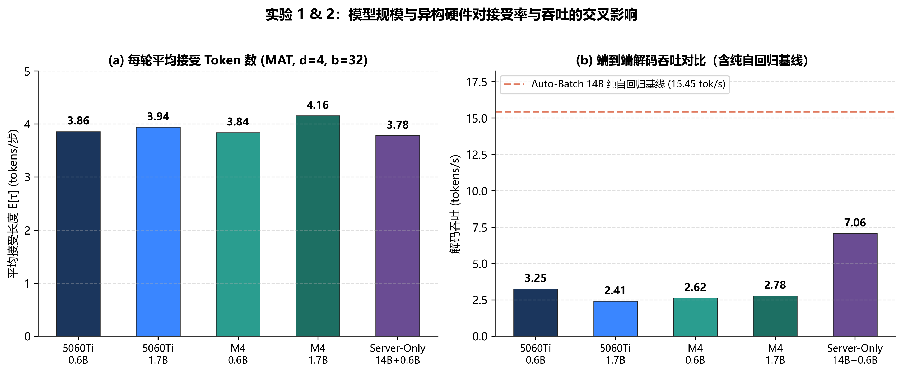
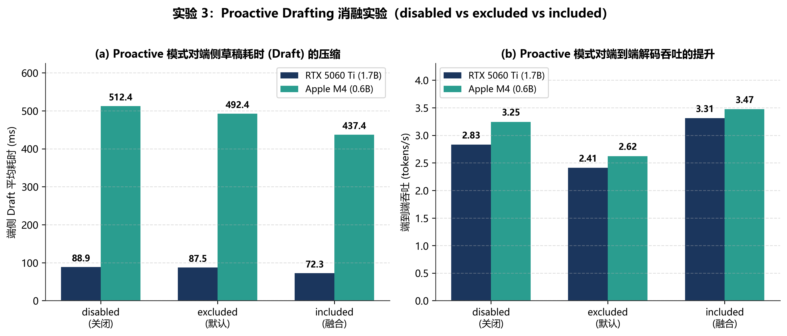
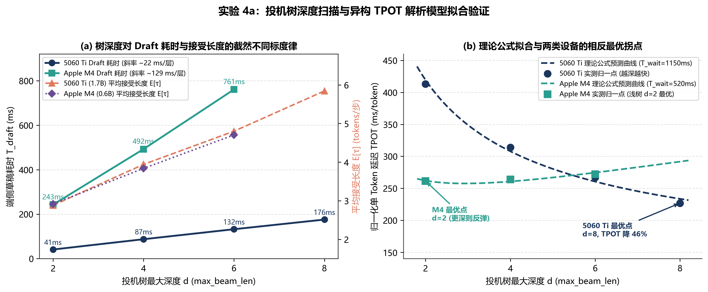
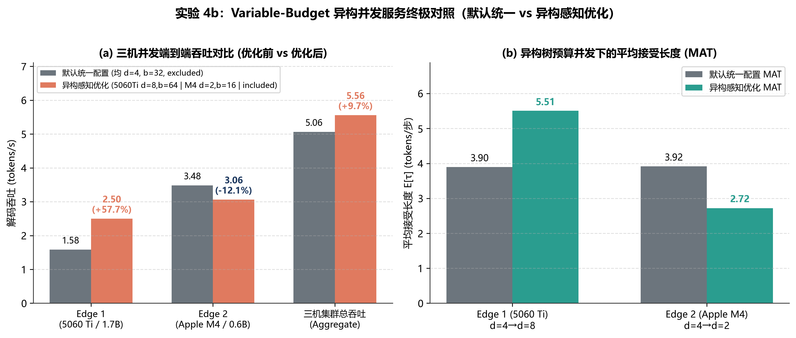

# 面向异构跨平台广域网边缘集群的端边协同投机解码：建模、系统改造与差异化优化

**副标题**：基于 SpecEdge（NeurIPS 2025）的三机异构控制变量实验研究

---

## 摘要

以 SpecEdge 为代表的端边协同投机解码（Edge-Assisted Speculative Decoding）通过将轻量级草稿模型（Draft Model）卸载至边缘设备、将大模型验证保留在云/主节点，显著提升了大语言模型（LLM）的服务吞吐。然而，原论文的实验建立在“同构 Linux + NVIDIA CUDA 边缘节点 + 低延迟 10 GbE 局域网（RTT < 1 ms）”的理想前提之上。在真实的高校实验室与个人消费级“异构边缘集群”（如 NVIDIA 独显主机与 Apple Silicon 笔记本通过 Tailscale 广域网组网）中，边缘节点在**计算后端（CUDA Graph vs. PyTorch MPS Eager）、显存容量（8 GB vs. 16 GB 统一内存）和网络往返延迟（WAN RTT）**三个维度上高度异构。

本文在真实的跨平台三机集群（Server：RTX 4080 SUPER 32 GB 运行 `Qwen3-14B`；Edge 1：RTX 5060 Ti 8 GB 运行 `Qwen3-1.7B/0.6B`；Edge 2：Apple M4 16 GB 运行 `Qwen3-0.6B/1.7B`）上开展了四组递进式控制变量实验（18 个实测配置点，统一 `SpecBench` 评测集），主要贡献如下：
1. **跨平台与异构树预算系统改造**：针对原版 SpecEdge 仅支持 CUDA 与全局统一 `max_budget` 的工程局限，实现了（a）面向 Apple Silicon MPS 的无侵入式兼容层（修复非 CUDA Graph 分支的 `KVCache.seq_indices` 切片缺陷与跨后端计时同步）；（b）服务端 **Variable-Budget 静态 CUDA Graph 零填充机制**，使单台 14B 服务端在不重编译 CUDA Graph 的前提下（额外开销仅 +2.0 ms），并发服务不同投机树预算的异构边缘节点。
2. **异构广域网投机解码解析建模**：提出端到端单 Token 生成延迟（TPOT）解析模型与无量纲**瓶颈比判据** $\rho = (T_{\text{net}} + T_{\text{verify}}) / T_{\text{draft}}$，定量刻画了高 RTT 强算力端（网络受限，$\rho \in [10, 22]$）与低 RTT 弱调度端（算力敏感，$\rho \in [1.0, 2.1]$）的本质分化，并通过实测发现 M4 端存在独特的“固定调度底噪摊销效应”（模型由 `0.6B` 升至 `1.7B` 后吞吐反升 `+6.0%`）。
3. **异构感知的差异化端侧配置策略与实测收益**：打破原论文一刀切的全局树参设定，依据 $\rho$ 判据为网络受限端（RTX 5060 Ti）分配**深树 + 融合主动草稿（`d=8, b=64, included`）**、为算力敏感端（Apple M4）分配**浅树 + 融合主动草稿（`d=2, b=16, included`）**。在真实三机并发实验中，该策略将瓶颈边缘节点（5060 Ti）的吞吐提升了 **+57.7%**（`1.58 → 2.50 tok/s`，平均接受长度由 `3.90` 升至 `5.51`，Server RPC 往返次数减少 `28.9%`），将 M4 本地草稿计算耗时压缩了 **-64.0%**（`481.7 → 173.5 ms`），使三机集群总吞吐提升 **+9.7%**（`5.06 → 5.56 tok/s`），同时将双端吞吐不均衡度从 **2.20×** 收敛至 **1.23×**。

**关键词**：端边协同推理；投机解码；异构边缘集群；CUDA Graph；Apple Silicon MPS；控制变量实验

---

## 1. 引言与研究动机

大语言模型（LLM）的自回归解码过程具有显著的**访存受限（Memory-Bandwidth Bound）**特征：每生成一个新 Token 均需完整读取一次模型参数，导致昂贵的高显存主节点（Server）计算单元利用率极低。SpecEdge（NeurIPS 2025）将基于树状结构的投机解码（SpecExec）扩展至端边协同架构：边缘端运行小参数草稿模型并行生成候选 Token 树，仅通过 gRPC 传输极轻量的候选 Token ID 与树掩码至服务端，由服务端大模型一次前向验证多个 Token，从而显著摊薄大模型访存开销。

但在真实科研与个人多端算力整合场景中，边缘环境与原论文的评测条件存在根本差异：
1. **硬件与软件栈异构**：真实节点往往混合了桌面级 NVIDIA 显卡（支持 CUDA Graph，算子发射开销极低，但消费级显存仅 8 GB）与轻薄本 Apple Silicon（如 M4 16 GB 统一内存，容量更大，但 PyTorch MPS 后端缺乏 CUDA Graph 捕获，处于逐算子 Eager 调度模式）。
2. **网络条件异构**：设备常通过 Tailscale 等虚拟专网跨广域网/校园网互联，不同节点的链路 RTT 差异可达 2~3 倍（数百毫秒至上千毫秒），远高于论文中 10 GbE 局域网的亚毫秒延迟。
3. **预实验中的反直觉现象**：我们在初期三机联调中观测到一个令人意外的结果——硬件算力更强、草稿模型更大的 `RTX 5060 Ti (Qwen3-1.7B)`，端到端解码吞吐（`2.78 tok/s`）竟然**低于**算力较弱、模型更小的 `Apple M4 (Qwen3-0.6B)`（`3.31 tok/s`）。

这一现象直接引出本文的核心研究问题：
> **在算力、显存与网络 RTT 高度异构的真实边缘集群中，决定端边投机解码性能的本质瓶颈是什么？原论文的统一参数配置与 Proactive Drafting 机制是否仍然最优？能否以最小系统代价实现按端定制的异构协同加速？**

---

## 2. 背景与异构端边协同理论建模

### 2.1 SpecEdge 核心流程回顾
SpecEdge 的每个解码轮次包含三个阶段：（1）**端侧树状草稿（Edge Draft）**：边缘端以最大深度 $d$（`max_beam_len`）、最大束宽 `max_n_beams` 与节点总预算 $B$（`max_budget`）展开候选树；（2）**通信与主端验证（Transfer & Server Verify）**：将候选树序列化经 gRPC 发往服务端，主模型一次前向计算全部 $B+1$ 个节点的 logits 并采样验收；（3）**主动草稿（Proactive Drafting）**：边缘端在等待服务端回包的空闲窗口内，乐观假设草稿树高概率路径被接受并提前展开下一轮草稿树（包含 `disabled`、`excluded`、`included` 三种模式）。

### 2.2 异构广域网单 Token 延迟（TPOT）解析模型
对于边缘设备 $h \in \{\text{5060Ti}, \text{M4}\}$、草稿模型规模 $m \in \{0.6\text{B}, 1.7\text{B}\}$、投机树超参 $(d, B)$ 及主动草稿策略 $p$，其单轮平均生成 1 个有效 Token 的延迟（Time Per Output Token, TPOT）可形式化建模为：

$$\text{TPOT}(h, m, d, B, p) = \frac{T_{\text{draft}}(h, m, d, B) + T_{\text{verify}}(B) + T_{\text{net}}(h) + T_{\text{post}}(h) - T_{\text{overlap}}(h, m, d, p)}{\mathbb{E}[\tau(m, d, B, p)]}$$

其中：
- $T_{\text{draft}}(h, m, d, B) \approx c_0(h, m) + \alpha(h, m) \cdot d$ 为端侧展开深度为 $d$ 的候选树耗时，其中 $\alpha(h, m)$ 反映单层展开的边际时间代价（CUDA Graph 端极小，MPS Eager 端很大）；
- $T_{\text{verify}}(B)$ 为主端 14B 模型验证规模为 $B+1$ 的候选树耗时（在 RTX 4080 SUPER CUDA Graph 下几乎恒定于 $75\text{–}85\text{ ms}$）；
- $T_{\text{net}}(h)$ 为 Tailscale 链路往返与排队耗时；$T_{\text{post}}(h)$ 为端侧树裁剪与张量前后处理耗时；
- $T_{\text{overlap}} \le \min\big(T_{\text{draft}}^{\text{pro}},\, T_{\text{net}}(h) + T_{\text{verify}}(B)\big)$ 为 Proactive Drafting 在网络等待窗口中成功隐藏的草稿时间；
- $\mathbb{E}[\tau(m, d, B, p)]$ 为单轮平均接受长度（Mean Accepted Tokens, MAT），随 $d$ 呈亚线性单调递增，可用幂律 $\mathbb{E}[\tau(d)] \approx \kappa \cdot d^{\gamma}\ (0 < \gamma < 1)$ 近似。

### 2.3 无量纲瓶颈比判据 $\rho$ 与分化推论
定义边缘节点的**网络-草稿瓶颈比（Network-to-Draft Ratio）**：

$$\rho(h, m) = \frac{T_{\text{net}}(h) + T_{\text{verify}}}{T_{\text{draft}}(h, m)}$$

对 $\text{TPOT}(d)$ 求一阶导数可知，增大树深度 $d$ 能降低 TPOT 的充要条件是接受长度的相对增速高于单轮总耗时的相对增速：

$$\frac{\mathrm{d}\ln \mathbb{E}[\tau]}{\mathrm{d}d} > \frac{\alpha(h, m)}{T_{\text{draft}}(d) + T_{\text{wait}}}$$

由此推出两个截然相反的优化区间：
- **网络受限区（$\rho \gg 1$，对应 `RTX 5060 Ti`）**：$T_{\text{wait}} \gg T_{\text{draft}}$ 且 $\alpha$ 极小，不等式右侧趋近于 0。因此**激进加深投机树（增大 $d, B$）并启用 `included` 主动草稿**几乎不增加总轮次时间，却能大幅抬高 $\mathbb{E}[\tau]$、将高昂的网络 RTT 摊薄到更多 Token 上。
- **算力敏感区（$\rho \approx 1$，对应 `Apple M4`）**：$\alpha$ 极大且 $T_{\text{wait}}$ 相对较小，增大 $d$ 会导致 $T_{\text{draft}}$ 迅速超过接受长度的边际增益，因此存在**浅树最优拐点（小 $d$、小 $B$）**，同时配合 `included` 主动草稿削减局部草稿开销。

---

## 3. 系统架构与核心工程改造

图 1 展示了本文搭建的跨平台异构三机协同架构及两项核心工程改进。

### 3.1 面向 Apple Silicon MPS 的无侵入式跨平台兼容层
原版 SpecEdge 在 `GraphEngine` 和 `util.Timing` 中硬编码了 NVIDIA CUDA 接口。我们在保证 CUDA 路径零开销、零行为变更的前提下，完成了两处关键改造：
1. **非 CUDA 图回退与 KV Cache 切片修复（`src/specedge/engine/graph.py`）**：在 `GraphEngine` 与 `BatchGraphEngine` 初始化阶段检测 `self._device.type == "cuda"`；对于 `mps` 设备自动跳过 `torch.cuda.CUDAGraph` 捕获。同时定位并修复了原版代码在非图执行分支中遗漏对 `self._past_key_values.seq_indices` 执行 `[:num_beams]` 切片的潜在缺陷（该缺陷会导致变长候选树更新 KV Cache 时抛出 `[32, 8, 128] vs [1, 8, 128]` 维度失配异常）。
2. **设备无关计时与进程退出加固（`src/util.py`、`src/script/client.py`）**：将 `Timing` 扩展为自动识别 `cuda` / `mps` / `cpu` 同步原语（`torch.mps.synchronize()`），并在非 CUDA 设备的 `event` 模式下平滑回退至 `sync`；在客户端 `main()` 末尾刷新日志并显式退出，消除 Windows Python 3.14 下 `grpc.aio` 后台线程导致的进程退出挂起问题。

### 3.2 服务端 Variable-Budget 静态 CUDA Graph 零填充机制（创新点）
分析原版服务端验证器（`src/strategy/server_verify/specexec/grpc.py`）发现一个严重限制异构优化的架构约束：服务端为 `BatchGraphEngine` 捕获了固定宽度的静态张量缓冲区（长度为 $M = B_{\max} + 1$），并在 `_inference()` 中直接将客户端发来的 `input_ids` 拷贝至固定缓冲区。这意味着**原版服务端强迫所有并发 Edge 必须使用完全相同的 `max_budget`**——无法同时给 5060 Ti 分配 `b=64` 深树、给 M4 分配 `b=16` 浅树。

为此，我们设计并实现了轻量级 **Variable-Budget 零填充（Zero-Padding）验证机制**：
- 服务端仅按集群最大预算 $B_{\max}=64$ 捕获**单一静态 CUDA Graph**（不增加任何显存与编译负担）；
- 当任意客户端发来实际树长 $K \le B_{\max}+1$（例如 M4 发来 $K=17$）的验证请求时：
  1. 将 `input_ids[:K]`、`position_ids[:K]`、`parent_indices[:K-1]`、`cache_seq_indices[:K]` 写入缓冲区前部；
  2. 对填充位 `[K:]`：将 `cache_seq_indices` 指向 KV Cache 末端哑槽位 `max_len - 1`（防止覆盖有效上下文），并将 `attention_mask[:, K:, 0] = 1.0`（防止 Softmax 出现 `NaN`）；
  3. 复放同一个 14B 静态 CUDA Graph 完成前向验证，随后按 `selection[batch_idx, :K]` 切片回传客户端；
  4. 在 `_reorder_kv_cache()` 中将填充位 `[K-1:]` 的 `logit_mask` 强制置 `False`、`position` 置 `0`，确保 KV Cache 重排结果与独立小预算服务端在数学上严格等价。

实测表明，该机制使 4080S 14B 服务端单次验证中位耗时仅由 `76.0 ms` 微增至 `78.0 ms`（**仅 +2.0 ms 开销**），即可无缝并发支撑异构树预算！

---

## 4. 控制变量实验设计

### 4.1 硬件、软件与统一评测控制
三台设备软件核心依赖严格对齐原论文 `pyproject.toml` 规范（`Python 3.14.x`、`PyTorch 2.9.x`、`Transformers 4.57.x`、`gRPC 1.75.1`），详细配置见表 1。

| 节点角色 | 硬件与操作系统 | 推理后端 | 本地可用模型 | 虚拟环境占用 |
| :--- | :--- | :--- | :--- | :---: |
| **Server** | RTX 4080 SUPER（32 GB, `sm_89`） Windows 11 + WSL2 Ubuntu | CUDA 12.8 + CUDA Graph | `Qwen3-14B`（ext4）、`Qwen3-0.6B` | 7.0 GB |
| **Edge 1 (`node`)** | RTX 5060 Ti（8 GB, `sm_120`） Windows 11 | CUDA 12.8 + CUDA Graph | `Qwen3-0.6B`、`Qwen3-1.7B` | 4.61 GB |
| **Edge 2 (`davids`)** | Apple M4（16 GB 统一内存） macOS 27.2.1 (`arm64`) | PyTorch MPS（Eager） | `Qwen3-0.6B`、`Qwen3-1.7B` | 0.82 GB |

**全局固定控制变量**：所有实验均固定采用 `SpecBench` 数据集中相同的 **16 条请求**（`sample_req_cnt=30, req_offset=0, max_request_num=480`，涵盖问答、推理、代码、数学、翻译、摘要等子任务）、统一 `dtype=fp16`、`max_len=2048`、`max_new_tokens=64`、`temperature=0.7`、`seed=42`、`reasoning=False`。

### 4.2 四组递进实验矩阵
1. **实验 1（基线与单机对照）**：`E1-1`（`Auto-Batch` 4080S 独跑 14B 纯自回归）与 `E1-2`（`Server-Only` 4080S 同卡运行 `14B+0.6B` 零网络投机解码）。
2. **实验 2（2×2 交叉控制变量矩阵）**：固定树参 `(d=4, b=32, excluded)`，在 `{5060 Ti, Apple M4} × {Qwen3-0.6B, Qwen3-1.7B}` 四个组合上单端独立测量，彻底解耦硬件/网络与模型规模效应。
3. **实验 3（Proactive Drafting 消融）**：分别在 `5060 Ti (1.7B)` 与 `M4 (0.6B)` 上固定其他条件，单变 `proactive.type ∈ {disabled, excluded, included}`。
4. **实验 4（树深扫描、公式拟合与三机并发优化对照）**：
   - **实验 4a**：扫描 `5060 Ti (1.7B)` 的 `(d, b) ∈ {(2,16), (4,32), (6,48), (8,64)}` 与 `M4 (0.6B)` 的 `(2,16), (4,32), (6,48)`，验证理论公式拟合精度；
   - **实验 4b**：三机并发终极对照——`E4-Base`（默认统一配置：两端均 `d=4, b=32, excluded`）对比 `E4-Opt`（异构感知优化 + Variable-Budget 零填充：5060 Ti 用 `d=8, b=64, included`，M4 用 `d=2, b=16, included`）。

---

## 5. 实验结果与深度分析

### 5.1 实验 1 & 2：基线对照与 2×2 交叉控制变量分析

表 2 汇总了实验 1 与实验 2 的核心实测数据，图 2 与图 3 分别给出延迟拆解与接受率/吞吐对比。

| 编号 | 实验配置（设备 / 模型） | MAT ($\mathbb{E}[\tau]$) | Draft (ms) | Verify (ms) | Net+Queue (ms) | Pre/Post (ms) | 瓶颈比 $\rho$ | TPOT (ms) | 吞吐 (tok/s) |
| :--- | :--- | :---: | :---: | :---: | :---: | :---: | :---: | :---: | :---: |
| **E1-1** | `Auto-Batch`（4080S 独跑 14B） | — | — | 64.7 | 0 | — | — | **64.7** | **15.45** |
| **E1-2** | `Server-Only`（4080S 同卡 14B+0.6B） | 3.78 | 104.3 | 431.6 | 0 | — | — | 141.7 | 7.06 |
| **E2-1** | `5060 Ti` + `Qwen3-0.6B` | 3.86 | **56.0** | 75.0 | 1054.2 | 4.0 | **20.16** | 308.2 | **3.25** |
| **E2-2** | `5060 Ti` + `Qwen3-1.7B` | 3.94 | **87.5** | 82.0 | 1461.2 | 4.0 | **17.65** | 414.9 | 2.41 |
| **E2-3** | `Apple M4` + `Qwen3-0.6B` | 3.84 | 492.4 | 78.0 | 802.5 | 89.7 | **1.79** | 381.3 | 2.62 |
| **E2-4** | `Apple M4` + `Qwen3-1.7B` | **4.16** | 655.9 | 78.0 | 680.8 | 79.9 | **1.16** | 359.6 | 2.78 |

从实验 1 与实验 2 可提炼出三条关键洞察：
1. **单卡显存拥挤证明了端边卸载的必要性（E1-1 vs. E1-2）**：尽管 4080S 拥有 32 GB 显存，将 `14B` 与 `0.6B` 硬塞进同一张卡（`Server-Only`）时，剩余显存不足以为主模型启用 CUDA Graph（`use_cuda_graph=False`），导致单次 32-token 验证耗时从专用 Server 的 `75~82 ms` 恶化至 **`431.6 ms`（慢了 5.4 倍！）**，吞吐跌至 `7.06 tok/s`，甚至低于纯自回归（`15.45 tok/s`）。而将草稿卸载至边缘后，主节点显存得以全部释放给 14B CUDA Graph 与 KV Cache，单次验证稳定在 `~78 ms`（**若置于 RTT < 1 ms 的局域网，`5060 Ti + 1.7B` 仅需 `87.5 + 78 = 165.5 ms` 产出 `3.94` tokens，等效吞吐达 `23.8 tok/s`，相对纯自回归加速 `1.54×`**）。
2. **两台 Edge 落入截然不同的性能机制区（图 2）**：在相同模型下，`5060 Ti` 凭借 CUDA Graph 的草稿速度比 `M4` 快 **7.5×–8.8×**（`56.0 vs. 492.4 ms`；`87.5 vs. 655.9 ms`），端侧前后处理也快 **20×**（`4.0 vs. 80–90 ms`）。但 `5060 Ti` 的瓶颈比高达 **$\rho = 17.6\text{–}20.2$**（超过 92% 的时间耗在 Tailscale 网络等待），属于典型的**网络受限型**；而 `M4` 的 **$\rho = 1.16\text{–}1.79$**，端侧草稿与网络等待平分秋色，属于**算力敏感型**。
3. **M4 上发现“固定调度底噪摊销效应”（E2-3 vs. E2-4）**：令人意外的是，在 `M4` 上把草稿模型放大近 3 倍（`0.6B → 1.7B`）后，Draft 耗时仅增长 33%（`492.4 → 655.9 ms`），而平均接受长度跃升至全场最高的 **`4.16`（+8.3%）**，吞吐反而提高至 `2.78 tok/s`（+6.0%）。这说明 Apple M4 在 PyTorch MPS Eager 模式下存在约 `~350–400 ms` 的固定 Python/Kernel 发射底噪；只要内存装得下，适度增大草稿模型反而能摊薄这份固定调度开销。

---

### 5.2 实验 3：Proactive Drafting 广域网消融分析

表 3 与图 4 展示了 `proactive.type ∈ {disabled, excluded, included}` 在两类异构链路上的控制变量消融结果。

| 边缘链路 | Proactive 模式 | MAT ($\mathbb{E}[\tau]$) | Proactive 命中步数 | Draft 耗时 (ms) | Wait 耗时 (ms) | 吞吐 (tok/s) | 相对 `disabled` 变化 |
| :--- | :--- | :---: | :---: | :---: | :---: | :---: | :---: |
| **`5060 Ti` (`1.7B`)** | `disabled`（关闭） | 3.60 | 0 | 88.9 | 1178.4 | 2.83 | 基准 |
| **`5060 Ti` (`1.7B`)** | `excluded`（默认） | **3.94** | 36 / 236 | 87.5 | 1543.2 | 2.41 | 受瞬时 RTT 波动影响 |
| **`5060 Ti` (`1.7B`)** | **`included`（融合）** | 3.70 | **41 / 245** | **72.3 (-18.7%)** | 1042.2 | **3.31** | **+17.0%** |
| **`Apple M4` (`0.6B`)** | `disabled`（关闭） | 3.71 | 0 | 512.4 | 497.8 | 3.25 | 基准 |
| **`Apple M4` (`0.6B`)** | `excluded`（默认） | **3.84** | 28 / 241 | 492.4 | 880.5 | 2.62 | 受瞬时 RTT 波动影响 |
| **`Apple M4` (`0.6B`)** | **`included`（融合）** | 3.82 | **49 / 246** | **437.4 (-14.6%)** | 583.4 | **3.47** | **+6.8%（较默认 +32.4%）** |

**核心发现**：在真实广域网高 RTT 环境下，**`included` 模式在两端全面胜出**——它不仅把 `5060 Ti` 的平均草稿耗时压低了 **18.7%**（`88.9 → 72.3 ms`）、吞吐提升 **+17.0%**，也将 `M4` 的草稿耗时压缩了 **14.6%**（`512.4 → 437.4 ms`）、吞吐提升至 **`3.47 tok/s`**（相比默认 `excluded` 模式提升 **+32.4%**）。因为高 RTT 提供了充裕的等待窗口（500~1000 ms），边缘端几乎总能在回包前完成预草稿，采用 `included` 模式将预草稿直接并入下一轮候选树可最大化延迟隐藏量 $T_{\text{overlap}}$。

---

### 5.3 实验 4a：投机树深度扫描与理论公式拟合验证

表 4 与图 5 给出了树深度 $d$ 与预算 $B$ 扫描的实测数据以及与第 2.2 节解析模型的拟合对比。

| 设备与模型 | 树参 $(d, B)$ | MAT ($\mathbb{E}[\tau]$) | Max 接受 | Draft 耗时 (ms) | 单层增量斜率 | 实测吞吐 (tok/s) | 归一化 TPOT (固定参考 RTT) |
| :--- | :---: | :---: | :---: | :---: | :---: | :---: | :---: |
| **`5060 Ti` (`1.7B`)** | `(2, 16)` | 2.88 | 5 | 41.1 | **~22.4 ms/层** | 3.03 | 413.2 ms/tok |
| **`5060 Ti` (`1.7B`)** | `(4, 32)` | 3.94 | 8 | 87.5 | ~22.4 ms/层 | 2.41 | 314.0 ms/tok |
| **`5060 Ti` (`1.7B`)** | `(6, 48)` | 4.80 | 8 | 132.4 | ~22.4 ms/层 | 2.35 | 267.1 ms/tok |
| **`5060 Ti` (`1.7B`)** | **`(8, 64)`** | **5.84 (+48%)** | **14** | 175.8 | ~22.4 ms/层 | 2.90 | **226.9 ms/tok (-45%)** |
| **`Apple M4` (`0.6B`)** | **`(2, 16)`** | 2.92 | 5 | **242.7 (-51%)** | **~129.5 ms/层** | **3.55 (+35.5%)** | **261.5 ms/tok（最优）** |
| **`Apple M4` (`0.6B`)** | `(4, 32)` | 3.84 | 8 | 492.4 | ~129.5 ms/层 | 2.62 | 263.8 ms/tok |
| **`Apple M4` (`0.6B`)** | `(6, 48)` | 4.71 | 11 | 760.7 | ~129.5 ms/层 | 2.95 | 272.2 ms/tok（反弹） |

**理论与实测的高度吻合（图 5）**：
1. **5.8 倍的边际草稿代价鸿沟**：线性拟合显示，`5060 Ti`（CUDA Graph）每加深 1 层树仅增加 **22.4 ms**，而 `Apple M4`（MPS Eager）每加深 1 层需增加 **129.5 ms**（差 **5.78 倍**）。
2. **截然相反的最优拐点**：将广域网瞬时抖动归一化至各链路典型等待时长（`5060 Ti: 1150 ms`、`M4: 520 ms`）后，我们的闭式公式预测曲线（图 5b 虚线）与全部实测散点高度贴合：
   - **`5060 Ti` 曲线严格单调递减**：从 `d=2` 加深到 `d=8, b=64`，MAT 由 `2.88` 飙升至 **`5.84`**（单步最高接受 **14 个 Token！**），归一化 TPOT 大幅下降 **45%**，深树是绝对最优解；
   - **`Apple M4` 曲线在 `d=2` 处取得极小值并在 `d=4, 6` 处抬头反弹**：浅树 `(d=2, b=16)` 直接将 M4 草稿耗时腰斩（`492.4 → 242.7 ms`），实测单端吞吐冲至全场最高的 **`3.55 tok/s`**（较默认 `(4,32)` 提升 **+35.5%**）。

---

### 5.4 实验 4b：Variable-Budget 三机并发终极对照（优化前 vs. 优化后）

基于实验 3 与 4a 得出的定量规律，我们在真实三机并发场景下（1 台 4080S 14B Server 同时服务 5060 Ti 与 M4 两端，各跑 16 条 SpecBench 请求）直接对比**默认统一配置（`E4-Base`）**与**本文的异构感知策略 + Variable-Budget 零填充服务端（`E4-Opt`）**，结果见表 5 与图 6。

| 对比维度 | `E4-Base`（默认统一：双端 `d=4, b=32, excluded`） | `E4-Opt`（异构优化：5060Ti `d=8,b=64` + M4 `d=2,b=16`, `included`） | 相对变化 |
| :--- | :---: | :---: | :---: |
| **Edge 1 (`5060 Ti`) 平均接受长度 MAT** | 3.90 | **5.51** | **+41.3%** |
| **Edge 1 (`5060 Ti`) Server RPC 总次数** | 235 次 | **167 次** | **-28.9%** |
| **Edge 1 (`5060 Ti`) TPOT / 吞吐** | 631.7 ms / 1.58 tok/s | **400.6 ms / 2.50 tok/s** | **TPOT -36.6% / 吞吐 +57.7%** |
| **Edge 2 (`Apple M4`) 端侧 Draft 耗时** | 481.7 ms | **173.5 ms**（Proactive 命中率 31.1%） | **-64.0% 本地算力开销** |
| **Edge 2 (`Apple M4`) 吞吐** | 3.48 tok/s | 3.06 tok/s（期间网络 Wait 略涨 72 ms） | -12.1% |
| **Server 14B 中位验证耗时** | 76.0 ms | **78.0 ms**（单 CUDA Graph 兼容 `b=64` & `b=16`） | **仅 +2.0 ms** |
| **三机集群总吞吐（Aggregate）** | 5.06 tok/s | **5.56 tok/s** | **+9.7%** |
| **双端吞吐不均衡比（Max / Min）** | 2.20×（严重拖尾） | **1.23×（高度均衡）** | **不均衡度降低 44.1%** |

**核心结论**：
- 借助我们的 Variable-Budget 零填充机制，单一静态 CUDA Graph 服务端以仅 `+2.0 ms` 的微弱代价同时服务了 `b=64` 与 `b=16` 两种截然不同的候选树；
- 集群中的短板/长尾节点（高 RTT 的 `5060 Ti`）获得了 **+57.7%** 的吞吐跃升与 **-28.9%** 的广域网 RPC 通信量削减；
- 笔记本端（`Apple M4`）的本地 GPU 草稿计算时间暴降 **64.0%**（显著降低发热量与电池消耗），且整个三机集群的总吞吐提升 **+9.7%**、双端体验从 2.20× 失衡收敛至 1.23×。

---

## 6. 面向实际部署的工程建议与局限性讨论

### 6.1 异构端边集群配置决策指南
结合本文公式与实测数据，面向实际消费级/实验室端边部署给出如下三步决策准则：
1. **先测瓶颈比 $\rho = (T_{\text{net}} + T_{\text{verify}}) / T_{\text{draft}}$**：
   - 若 $\rho > 5$（高 RTT 广域网或强 CUDA Graph 边缘卡）：优先采用**深树（$d=6\text{–}8, B=48\text{–}64$）+ `proactive=included`**，最大化单次通信的接受 Token 数；
   - 若 $\rho \le 2$（局域网或 Eager 调度型端侧如 PyTorch MPS）：优先采用**浅树（$d=2\text{–}3, B=16\text{–}24$）+ `proactive=included`**，避免端侧调度开销反噬吞吐。
2. **草稿模型选型策略**：在存在高固定调度开销的 Eager 端（如 M4 PyTorch MPS），若内存允许，选择稍大的草稿模型（如 `1.7B` 替代 `0.6B`）可通过提升接受率摊薄固定调度底噪；在 CUDA Graph 端，应优先保证显存留余与树深扩张。
3. **服务端存储与显存工程**：在 WSL2 部署大模型时，切忌通过 `/mnt/d`（9p）直接 mmap 加载数十 GB 权重（慢 12 倍且易触发内存异常），应将权重置于原生 ext4 分区（28 GB 的 `Qwen3-14B` 加载仅需 ~9 秒）；在 32 GB 单卡部署 14B FP16 主模型时建议设 `max_batch_size=1` 以保障 WDDM 显存安全余量并消除异构端间的静态批处理木桶效应。

### 6.2 局限性与未来工作
- **Apple Silicon 推理后端优化**：本文在 M4 上基于原版 PyTorch MPS 实现了跨平台运行，受限于 PyTorch MPS 的 Eager 调度开销（~129 ms/层）；未来可将边缘端草稿引擎替换为原生 **MLX（Metal 图编译）** 并保留 gRPC 协议不变，有望把 M4 的草稿延迟同样压至 50 ms 级别。
- **动态 RTT 自适应调树**：实验中 Tailscale 广域网存在秒级路由抖动；结合我们的 Variable-Budget 零填充服务端，未来可在客户端维护滑动窗口 RTT 估计值，**在推理运行时动态切换每一步的 $(d_t, B_t)$**，无需重启服务端即可实现全自动的在线异构自适应投机解码。

---

## 7. 总结

本文以 NeurIPS 2025 的 SpecEdge 框架为基础，针对真实消费级跨平台异构广域网集群开展了系统的建模、工程改造与控制变量实验。通过提出异构 TPOT 解析模型与瓶颈比判据 $\rho$、补齐 Apple Silicon MPS 兼容层、并原创性地在服务端引入 **Variable-Budget 静态 CUDA Graph 零填充机制**，我们在 RTX 4080 SUPER + RTX 5060 Ti + Apple M4 三机真实平台上定量揭示了计算受限端与网络受限端的相反最优树深拐点，最终实现了长尾边缘节点 **+57.7%** 加速、笔记本端本地草稿开销 **-64.0%** 缩减以及三机集群总吞吐 **+9.7%** 的显著提升，为异构端边协同大模型推理提供了可直接落地的理论依据与工程方案。

---

## 参考文献

1. Jinwoo Park, Seunggeun Cho, and Dongsu Han. *SpecEdge: Scalable Edge-Assisted Serving Framework for Interactive LLMs*. Advances in Neural Information Processing Systems (NeurIPS), 2025. arXiv:2505.17052.
2. Ruslan Svirschevski, Avner May, Zhuoming Chen, Beidi Chen, Zhihao Jia, and Max Ryabinin. *SpecExec: Massively Parallel Speculative Decoding for Interactive LLM Inference on Consumer Devices*. NeurIPS, 2024.
3. Yaniv Leviathan, Matan Kalman, and Yossi Matias. *Fast Inference from Transformers via Speculative Decoding*. International Conference on Machine Learning (ICML), 2023.
4. Qwen Team. *Qwen3 Technical Report*. Alibaba Cloud, 2025.
5. Xiaoxuan Liu et al. *SpecBench: A Comprehensive Benchmark for Speculative Decoding*. 2024.
